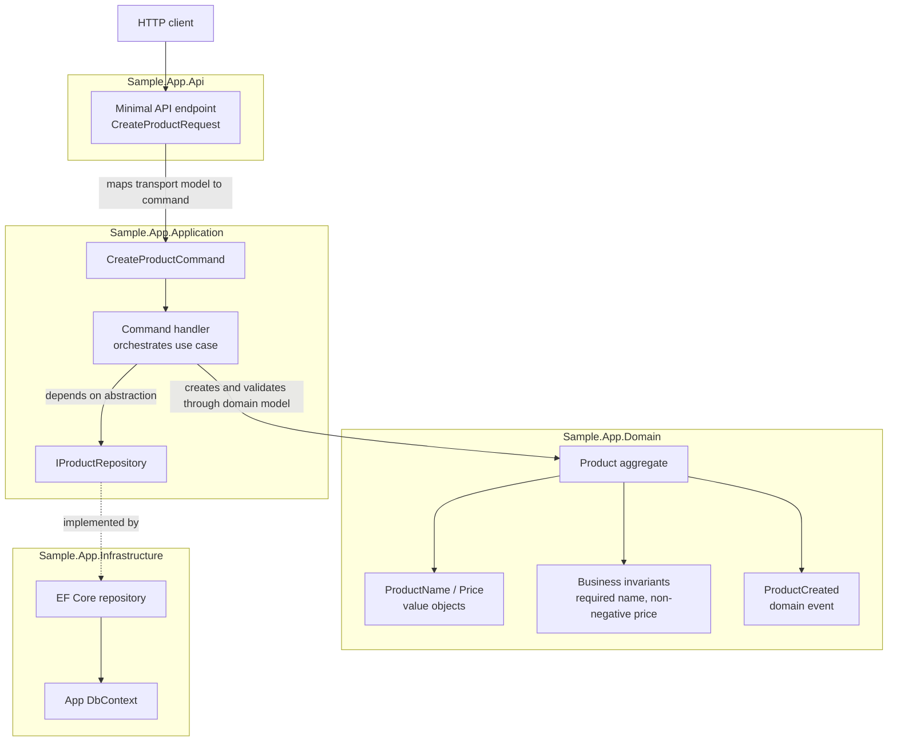

# Domain-Driven Design Architecture

Status: Approved

Created by: Sample Author <sample.author@example.com>

Created on: 2026-07-09

Applies to: `$myspec-implement` and implementation-focused findings from `$myspec-quantify`

## Rule

Use Domain-Driven Design as the project architecture for business behavior and domain modeling.

Implementation changes must keep business rules, invariants, entities, value objects, domain services, and domain events in the relevant Domain project. Application projects should orchestrate use cases through commands, queries, handlers, ports, and transaction boundaries without owning domain rules. Infrastructure projects should provide persistence, external service, messaging, and framework integrations behind abstractions defined by the Domain or Application layers. UI and API projects should translate transport or presentation concerns into application requests and must not contain domain behavior.

When a change introduces or modifies a business concept, model it using ubiquitous language from the approved specification and place the behavior in the smallest domain type that owns the invariant. Avoid anemic domain changes where business decisions are left in controllers, pages, API endpoints, persistence models, or application orchestration code.

## Practical Example

For a change that lets the App API create a product, keep the request/response shape at the API boundary, orchestrate the use case in Application, enforce product rules in Domain, and persist through Infrastructure.

## Approval

- Approved by: Sample Author <sample.author@example.com>
- Approved on: 2026-07-09
